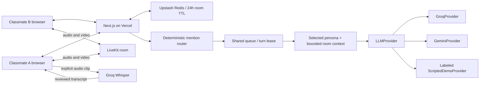
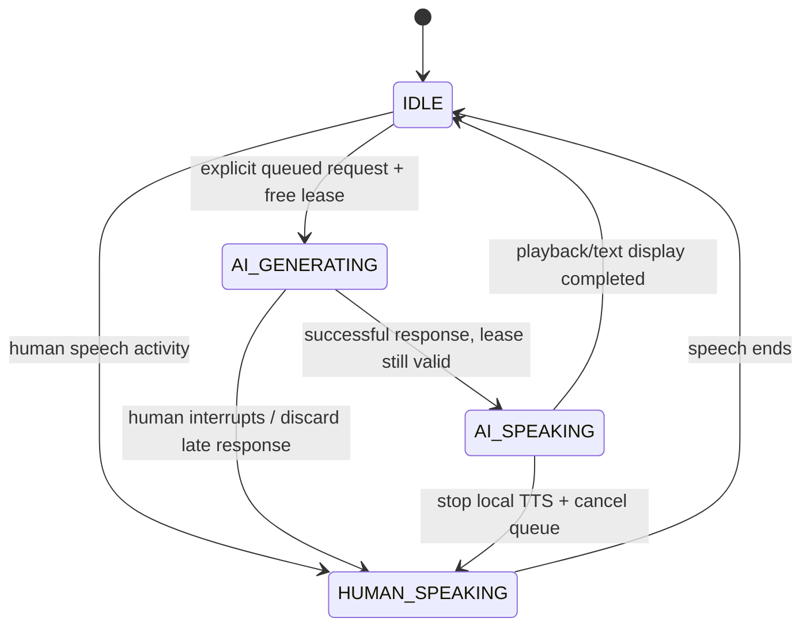

# Architecture

## Room and transport

The room URL contains a cryptographically random 96-bit capability. Joining creates a separate participant ID and a 256-bit bearer token; only its SHA-256 hash is stored. All reads and subsequent mutations require both. LiveKit tokens use this authenticated identity and grant access only to the associated room. Human names and AI identities cannot be selected freely in message payloads.

Chat is authoritative HTTP state, polled every 1.2 seconds while connected. This intentionally works independently from LiveKit: a media or AI outage cannot take down text communication. Media has no application recording path. In-memory storage supports one local server; Vercel requires Redis.

Redis writes compare the stored revision inside Lua, then atomically replace state while keeping the original expiry. Mutation callbacks have no external side effects and can safely retry. A generation request first claims a lease atomically, calls its provider outside the transaction, then checks the same turn ID before committing. A human interruption invalidates the ID, so late model output is discarded.

## Invocation and scheduling

No intent model decides whether a Mind may speak. `MentionRouter` requires a name at the beginning, a complete alias boundary, and an explicit request. `@` plus a request is accepted. Voice-style names require a conservative command/question prefix. A mention later in ordinary prose is context. Only enabled Minds are eligible; AI-generated text never enters the router.

One room holds one generation/speaking lease. Additional explicitly invoked jobs queue. A multi-Mind debate defaults to four turns, caps at six, and terminates. Bentham leads the ethics example. Human speech or a stop command clears the active turn and pending jobs. Speech ending does not restore a canceled queue. A playback owner acknowledges completion, with expiry as crash recovery.

Clients make `tick` requests while work is queued. This is request-driven processing rather than a background serverless task; at least one connected page must remain present. A lease prevents duplicate ticks from calling the model concurrently. Requests use bounded timeouts. Browser TTS is local to the claiming client; it is not an agent media track.

## Memory and persona isolation

The room keeps at most 60 recent visible messages before folding older entries into a rolling extractive summary and retaining 40. The model sees the last 24 messages and up to 6,000 summary characters, with a 26,000-character bound on assembled context. This summary is deliberately an extract, not a second uninvited model call. It can omit earlier nuances.

System instructions come from exactly one registry entry per request. Shared context includes human messages, previous Mind output and sent voice transcripts; other personas' system prompts are never included. The source text is untrusted context, not authority to change the chosen persona or scheduling rules.

## Conflicting student constraints

The study sprint scenario shares the same facts with Mediator and Judge: class ends at 4 pm, a work shift starts at 5:30 pm, the budget is $10, and the location should be quiet and on campus. They can reason differently about these facts. A suggestion must identify unknown travel time/availability and ask the students to confirm. The application exposes no tools to book, spend, message third parties or change schedules. A generated suggestion therefore cannot become a real commitment.

## Providers and failure boundaries

`LLMProvider.generate` accepts a provider-neutral prompt. `GroqProvider` discovers available model IDs at runtime. `GeminiProvider` uses the supported REST format with an explicit configured model. `ScriptedDemoProvider` is selected only with a missing provider key and explicit demo permission; actual provider errors remain errors.

The transcription endpoint authenticates the speaker, validates MIME/size, forwards an in-memory audio clip, and returns text for review. It does not save audio. `TTSProvider` and `AvatarProvider` keep the fallback presentation independent from model generation. An opt-in browser recognition controller now supports hands-free invocation without a server worker. Only final results enter the shared room, with speaker identity; interim text is visible locally and never invokes a Mind. Call mute and AI playback pause recognition, and errors disable it visibly. Speech activity updates and finalized messages are serialized per device, while server-side activity renewals preserve waiting requests. Browser recognition service availability is not guaranteed. Commercial avatars and server-side continuous STT still need a separate persistent worker; see the research notes.

## Boundaries before wider release

The prototype has invite capabilities rather than university SSO, per-room/member and creation limits rather than a full abuse platform, and polling rather than a durable event bus. Redis, Groq Cloud, Gemini, commercial avatars and Vercel still need credentialed production checks. Add multi-instance load tests, operational monitoring, moderation and stricter admission controls before broad campus use.
